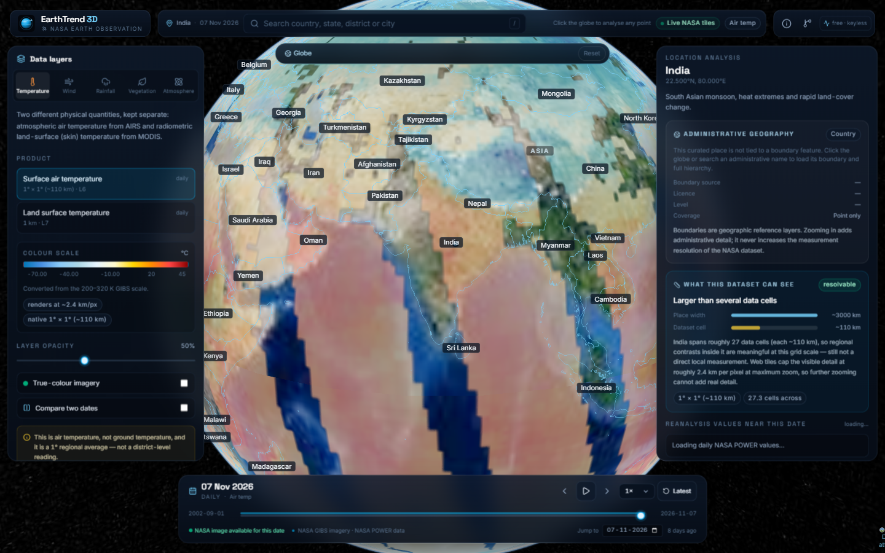
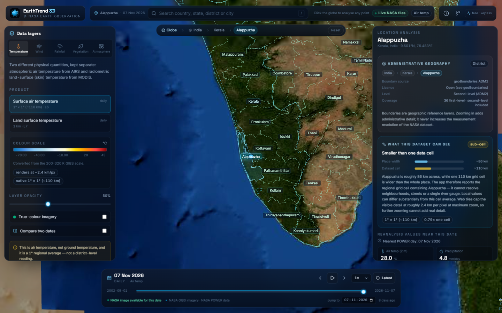
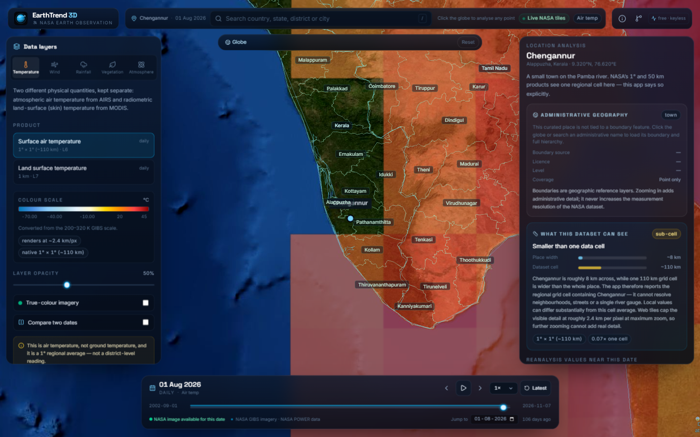

# EarthTrend 3D

A free, keyless 3D Earth observatory that combines **live NASA imagery**, **NASA reanalysis
point data**, and **honest statistics** in one interactive globe. Click anywhere on Earth to
see what the selected satellite product can actually resolve there, the latest available
values for that grid cell, and a Mann–Kendall/Sen's-slope trend with confidence intervals.

The same globe carries a **real administrative geography** — every country, its first-level
states/provinces, and second-level districts/counties where open boundary data exists — so
you can search, click, and navigate from the whole planet down to a district without ever
being shown an invented border.

Built with React 19, TypeScript, Vite, CesiumJS 1.147, Tailwind CSS 4, and Recharts.
No API keys, no paid services, no backend.



## What it does

- **Seven NASA GIBS products** across temperature, rainfall, vegetation, and atmosphere,
  streamed as live WMTS tiles for the selected date.
- **Global administrative drill-down**: country → state/province → district/county, with the
  local administrative term shown (State, Province, County, Municipality, LGA, …).
- **Global search** across every country and first-level division name plus 16,680
  second-level names, merged with a curated set of cities and towns.
- **True-colour MODIS Terra** and a static Blue Marble base map, with optional two-date
  swipe comparison.
- **Point analysis** on click or place search: nearest available POWER day, four reanalysis
  variables, and the dataset's native cell compared with the place footprint.
- **Trend testing** per point and season: Mann–Kendall significance, Sen's slope, 95 %
  Gilbert confidence interval, completeness, and z-score anomalies against a 1991–2020
  baseline.
- **Real wind vectors**: 10 m speed/direction at 12:00 UTC from Open-Meteo (GFS/ECMWF for
  recent dates, ERA5 archive for older dates), rendered as a particle field or as static
  arrows when the user prefers reduced motion.

## Administrative geography

Boundaries are a **reference layer**, separate from the environmental raster and point data.
They are rebuilt at build time by `npm run geo`, self-hosted under `/geo/`, and never
committed to git.

| Level | Source | Coverage | Licence |
| --- | --- | --- | --- |
| Country (ADM0) | Natural Earth 1:50m | 235 countries | Public domain |
| State / province (ADM1) | Natural Earth 1:10m | 249 countries, 4,596 features | Public domain |
| District / county (ADM2) | geoBoundaries `gbOpen` | 20 curated countries, 16,680 units | ODbL 1.0 / CC BY 4.0 per country |

The 20 second-level countries are **IND, USA, CAN, AUS, BRA, DEU, FRA, GBR, KEN, JPN, MEX,
ZAF, IDN, ESP, ITA, NGA, TUR, ARG, PHL, VNM**. Everywhere else the panel says second-level
data is unavailable; no boundary is synthesised to fill the gap. Each second-level unit is
attributed to its parent state/province by a point-in-polygon test against the level-1
geometry, so breadcrumbs and district searches resolve the real hierarchy.

Progressive loading follows camera altitude: country outlines at global scale, first-level
boundaries below ~8,000 km, second-level below ~1,500 km, and local labels below ~300 km.
Simplified geometry, memoised network requests, and altitude hysteresis keep the scene light.
Labels are drawn in an HTML overlay with greedy screen-space collision avoidance, and are
excluded from the areas covered by the header, side panels, breadcrumb, and timeline. Labels
belong to locations only — they are never produced by, or tied to, an environmental layer.



## Data and provenance

| Layer | Product | Native grid | Cadence | GIBS archive starts |
| --- | --- | --- | --- | --- |
| Air temperature | AIRS L3 Surface Air Temperature (day) | 1° (~110 km) | Daily | 2002-09-01 |
| Land surface temperature | MODIS/Terra Land Surface Temp (day) | 1 km | Daily | 2000-02-24 |
| Precipitation rate | GPM IMERG | 0.1° (~11 km) | Daily | 2000-06-01 |
| Precipitation (monthly) | MERRA-2 bias-corrected | 0.5° × 0.625° (~60 km) | Monthly | 1980-01-01 |
| NDVI | MODIS/Terra L3 NDVI | 1 km | Monthly | 2000-03-01 |
| Relative humidity | AIRS L3 Surface RH (day) | 1° (~110 km) | Daily | 2002-09-01 |
| Aerosol optical depth | MODIS/Terra AOD | 10 km | Daily | 2000-02-24 |
| Mid-tropospheric CO₂ | AIRS CO₂ | 2° | Daily | 2002-09-01 → **2012-02-01 only** |
| Wind speed | MERRA-2 monthly mean | 0.5° × 0.625° (~60 km) | Monthly | 1980-01-01 |

Sources:

- **NASA GIBS / EOSDIS** — imagery tiles (`gibs.earthdata.nasa.gov`, public, CORS-enabled).
- **NASA POWER** — point reanalysis series and nearest-day values (`power.larc.nasa.gov`).
- **Open-Meteo** — 10 m wind vectors only (`api.open-meteo.com` / `archive-api.open-meteo.com`,
  CC-BY 4.0, derived from ECMWF ERA5 and NOAA GFS). Not a NASA product; used because GIBS
  publishes wind *speed* without direction.
- **CesiumJS** — 3D globe, self-hosted build, no ion token.
- **Natural Earth / NASA Blue Marble** — base imagery via GIBS.

Every layer carries a per-product **publication lag** so the date bounds match what GIBS
actually has. AIRS lags ~8 days, MODIS/IMERG ~2 days, NDVI ~20 days, MERRA-2 monthly
~100 days. The app never relabels an older available day as "today".

## Honest resolution, not fake precision

The location panel explicitly classifies the selected place against the **rendered dataset's
native cell**:

- **Resolved** — the place spans several cells.
- **Marginal** — one to a few cells.
- **Sub-cell** — the place is smaller than one cell (e.g. Chengannur, ~8 km, inside a
  ~110 km AIRS cell or ~60 km POWER cell).

For sub-cell places the panel says the value is a regional cell average and that local
values can differ substantially. Imagery itself is capped by the GIBS Web-Mercator level
(~2.4 km/pixel at level 6), which is reported next to the native resolution, so extra zoom
is never presented as extra detail.

GIBS raster pixels are **not** sampled for point values. Values come from NASA POWER's
reanalysis grid, and the panel labels the nearest available POWER day. Vegetation, aerosol,
and CO₂ layers state that POWER publishes no matching point series.



## Trend methodology

- Monthly POWER values are converted to annual or seasonal aggregates.
- Missing values (`-999`) become null and are never treated as zero.
- An annual value requires at least 9 of 12 months; seasonal values require all three months.
  Precipitation is summed over valid months; temperature, wind, and humidity are averaged.
- Significance: two-sided **Mann–Kendall** test with tie correction and continuity correction
  at α = 0.05.
- Effect size: **Sen's slope** (median of all pairwise slopes) with a **Gilbert** rank-based
  95 % confidence interval.
- A trend is labelled significant only with at least 10 complete years. Otherwise the panel
  says the record is insufficient — not that nothing changed.
- Anomalies use the 1991–2020 baseline per calendar month.

Point trends use the POWER variable that matches the displayed quantity. If the displayed
layer has no POWER series, the trend card falls back to 2 m air temperature and labels the
change clearly.

## Wind: temporal handling

- Direction and speed are real **10 m model/reanalysis vectors at 12:00 UTC** on the selected
  date; only that exact hourly step is accepted.
- Recent dates (last 7 days) use the Open-Meteo forecast endpoint; older dates use the ERA5
  archive endpoint. The UI states which mode and valid hour were used.
- The MERRA-2 raster is a **monthly mean speed**. The vectors are a single-hour sample, not a
  monthly mean, and the layer caveat says so.
- Particle speed and trail length are **visual**, not physical; the About panel says this
  explicitly. Directions are real. Under `prefers-reduced-motion`, motion stops and static
  screen-space arrows are drawn instead.

## Live, cached, or illustrative

- **Live** — GIBS tiles and POWER requests are fetched from the public services at runtime.
  No data is pre-baked into the bundle.
- **Cached** — responses live in memory for the session (wind archive: 14 days, forecast:
  30 minutes). The UI marks POWER values as fetched just now or cached.
- **Illustrative** — only the wind particle speed/trail animation. No displayed number or
  raster pixel is simulated.

## Local development

Requirements: Node.js 22+ and npm.

```bash
npm install
npm run dev        # copies the Cesium runtime, then starts Vite
npm run typecheck
npm test           # 45 unit tests for geography, trends, dates, and resolution logic
npm run geo        # rebuild self-hosted boundaries under public/geo (cached downloads)
npm run verify:geo # 48 checks on global coverage, native terms, parents, payload sizes
npm run build      # copies Cesium, rebuilds boundaries, type-checks, builds, checks sizes
npm run preview    # serves dist on http://localhost:4173
```

The build copies Cesium's prebuilt IIFE runtime into `public/cesium` and loads it lazily at
runtime with `CESIUM_BASE_URL=/cesium/`. Cesium is not bundled by Vite, and no ion token is
used. Boundary payloads are generated into `public/geo` (gitignored) and self-hosted, so the
deployed site downloads no third-party boundary tiles. Every boundary download is non-fatal:
an offline build keeps the previous payloads, and a country with no second-level data simply
has that level reported as unavailable.

## Deploy to Netlify

The repository includes `netlify.toml`, so no dashboard configuration is required:

- Build command: `npm run build`
- Publish directory: `dist`
- Node version: 22
- Environment variables: none

`netlify.toml` also adds the SPA fallback (`/* → /index.html`, status 200), immutable
cache headers for `/cesium/*` and `/assets/*`, and a one-day cache for the rebuilt
`/geo/*` payloads.

To deploy from GitHub: **Netlify → Add new site → Import an existing project → GitHub →
choose this repository → Deploy**. The checked-in config supplies the rest.

## Performance and accessibility

- The Cesium runtime loads lazily after the app shell; the base map is static and is not
  rebuilt as dates step.
- Mobile uses fewer wind particles; layer and location panels are only mounted while open.
- `prefers-reduced-motion` replaces particle motion with static arrows.
- Keyboard search, labelled controls, focus-visible styles, and modal close buttons are
  included.

## Known limitations

- Second-level boundaries exist only for the 20 curated countries listed above. Other
  countries still drill down to real first-level divisions; their second level is reported
  as unavailable rather than approximated.
- Simplified boundary geometry is a cartographic reference, not a survey. Very small islands
  and enclaves may be omitted at the coarsest zoom, and boundaries near the antimeridian are
  stored as world-spanning boxes for hit-testing.
- Native grids are 1° (AIRS), ~0.1° (IMERG), ~0.5° (MERRA-2), or 1–10 km (MODIS). None of
  these is a neighbourhood measurement — an administrative boundary never increases the
  measurement resolution of the underlying dataset.
- AIRS has no retrieval under thick cloud; MODIS has gaps at bright surfaces and high
  latitudes; Web-Mercator tiles distort polar regions.
- Monthly means suppress storms and gusts. Trends describe a grid cell, not a causal
  attribution.
- AIRS CO₂ in GIBS ends on 2012-02-01; the app clamps dates and states the end date.
- Free endpoints can rate-limit; wind chunks are fetched sequentially with retries, and
  failures surface in the UI rather than being hidden.

## Attribution

NASA imagery and reanalysis: NASA EOSDIS/GIBS, NASA GES DISC, NASA GMAO, NASA POWER.
Wind vectors: Open-Meteo, derived from ECMWF ERA5 and NOAA GFS (CC-BY 4.0).
Globe: CesiumJS (Apache-2.0). See the in-app **About** panel for per-dataset citations and
caveats.
